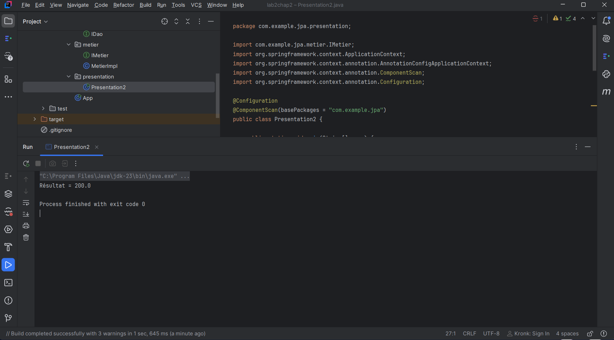
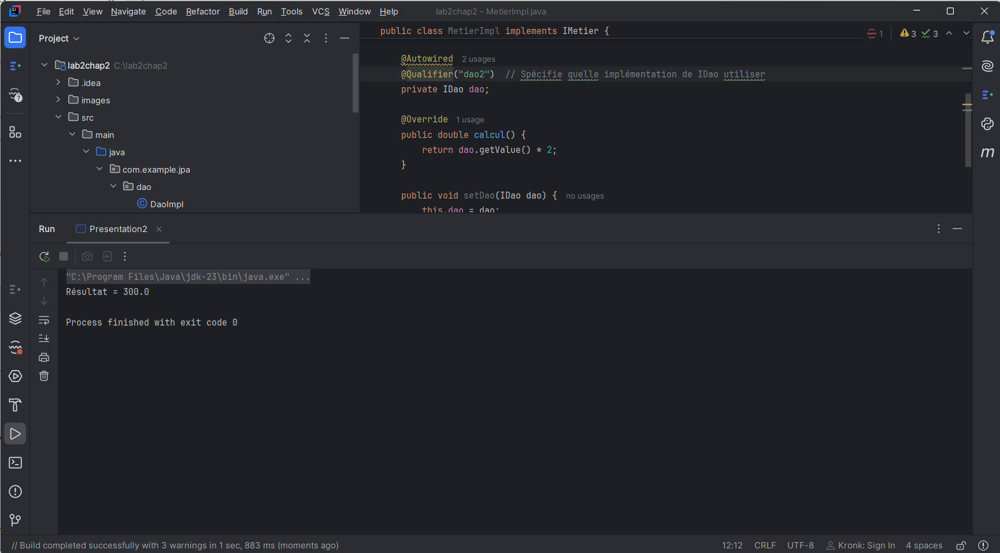

# TP 2 : Spring IoC (Inversion of Control)

## Objectif du TP

Ce TP a pour objectif de comprendre le principe de l'inversion de contrôle (IoC) et l'injection de dépendances avec le framework Spring.

Il permet de mettre en pratique la gestion des objets et de leurs dépendances à travers différentes méthodes de configuration.

## Technologies utilisées

- Java
- Spring Framework 6.1.2
- Maven
- IntelliJ IDEA

## Structure du projet

Le projet est organisé en trois couches principales :

- **DAO** : accès aux données.
- **Métier** : traitement et logique métier.
- **Présentation** : exécution et affichage des résultats.

## Résultats des exécutions

### 1. Première exécution — Presentation1

Cette première exécution permet de tester le fonctionnement de l'application avec la première méthode de configuration et d'injection des dépendances.

**Capture d'écran de l'exécution :**

### 2. Deuxième exécution — Presentation2

Cette deuxième exécution utilise Spring IoC avec les annotations `@Component`, `@Autowired` et `@ComponentScan`.

Spring se charge automatiquement de créer les objets et d'injecter les dépendances nécessaires.

**Capture d'écran de l'exécution :**

## Conclusion

Ce TP nous a permis de comprendre le fonctionnement de Spring IoC et l'intérêt de l'injection de dépendances pour réduire le couplage entre les différentes couches de l'application.
